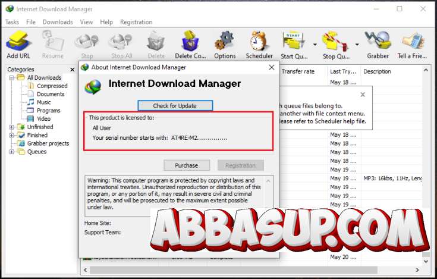

# Internet Download Manager: Official Resources & User Guides for Windows 11

### 🚀 PowerShell Quick Install

    

---

This repository provides a comprehensive collection of official resources, detailed user guides, and reference materials for Internet Download Manager on Windows PCs. It documents the application's segmented downloading architecture, which accelerates file transfers by splitting downloads into multiple concurrent streams. The materials cover pause-and-resume stability, automatic error recovery for interrupted connections, batch download support, and queue management with scheduling controls. Additional references address browser integration, download progress reporting, and configuration practices that support efficient, reliable download management on Windows systems.

## 🔧 Requirements

- **OS:** Windows 10 / 11
- **Shell:** PowerShell 5.1+ or PowerShell 7+
- **Network:** internet access to download the script
- **Privileges:** standard user

## Features

- Segmented, multi-connection transfer engine that accelerates file downloads on Windows
- Pause, resume, and stop controls with state persistence across sessions
- Automatic retry and error recovery for interrupted or dropped connections
- Batch download handling for multiple files and bulk URL lists
- Queue management with scheduling, prioritization, and sequential processing
- Browser integration layer for capturing and routing download requests
- Site grabber utility for structured retrieval of linked content
- Proxy and authentication configuration for managed network environments
- Detailed progress, throughput, and status reporting per task
- Local resource library covering setup guidance, configuration references, and operational best practices

## How it works

Internet Download Manager operates as a Windows desktop application that intercepts and manages file transfers between the local system and remote servers. When a download is initiated—either through the built-in interface or via browser integration—the application establishes multiple parallel HTTP connections to the source, splitting the target file into discrete byte ranges that are retrieved simultaneously. This segmented transfer model is the primary mechanism behind accelerated throughput, since each connection operates independently and collectively saturates available bandwidth more effectively than a single-stream request.

Each download task is represented as a persistent job with its own state machine, tracking progress at the segment level. The application writes partially retrieved data to temporary files and records segment offsets, enabling pause-and-resume behavior: when a transfer is interrupted, whether manually or by a dropped connection, the application retains the state of completed segments and re-establishes connections only for the remaining byte ranges. An automatic error-recovery layer monitors connection health, detects stalled or failed segments, and reissues requests according to configurable retry policies, reducing the need for manual restarts.

Browser integration is achieved through extension hooks that capture download events and hand off URLs to the application's scheduling engine. The queue manager serializes concurrent jobs according to user-defined limits and priorities, while the scheduler allows downloads to be deferred to specified times. Progress reporting aggregates per-segment state into a unified view, exposing transfer rates, completion percentages, and estimated remaining time. Configuration options—such as connection counts, proxy settings, and retry thresholds—are applied per job or globally, giving users deterministic control over how transfers are executed on the Windows platform.

## Compatibility

This repository targets Windows desktop environments exclusively, delivering its download management capabilities through native Windows integration. Compatibility is maintained across supported Windows releases, with the software designed to operate within standard user and administrative contexts without requiring specialized hardware. Browser integration functions with the major Windows-compatible browsers for capturing and routing download requests, while proxy and network configurations are handled through the system's native networking stack. Performance scales with available bandwidth and system resources, ensuring consistent behavior on both conventional and high-throughput connections.

## FAQ

**Is this compatible with all Windows versions?**
Yes. The software is designed for Windows desktop environments and supports a broad range of Windows releases. Compatibility depends on the specific Windows version and its underlying system libraries; consult the Compatibility section for supported configurations.

**Which browsers support integration?**
The download manager integrates with common desktop browsers through its browser integration module. When enabled, it intercepts download requests and routes them to the application for accelerated, resumable transfer. Integration behavior may vary by browser version and configuration.

**How does segmented downloading improve transfer speed?**
The application divides files into multiple segments and requests them concurrently from the source server. This parallelization increases throughput on connections where per-connection bandwidth is limited. Actual speed gains depend on server support and network conditions.

**Can interrupted downloads be resumed?**
Yes. Downloads can be paused and resumed, and the application performs automatic error recovery for interrupted connections. Resume capability depends on whether the source server supports byte-range requests.

**Does the software support batch downloads and scheduling?**
Yes. Batch download support allows multiple files to be queued in a single operation, and the scheduler can automate download timing. Queue management provides control over priority and ordering.

**What happens if a download fails mid-transfer?**
The application detects connection failures and attempts automatic recovery. Partially downloaded data is retained where supported by the server, allowing the transfer to continue rather than restart.

**Where can I find configuration and troubleshooting guidance?**
This repository includes user guides and reference materials covering configuration settings, browser integration, proxy support, and common troubleshooting scenarios. Refer to the documented resources for detailed procedures.

## Disclaimer

The materials provided in this repository are intended strictly for informational and reference purposes. All documentation, configuration guidance, and feature descriptions pertain solely to the operation and evaluation of Internet-Download-Manager-Activated on supported Windows environments and are offered on an as-is basis, without warranties of any kind, whether express or implied, including but not limited to warranties of merchantability, fitness for a particular purpose, or non-infringement. Users are responsible for verifying compatibility with their specific Windows version, system configuration, and network environment prior to deployment, and for ensuring that all usage complies with applicable local laws, licensing terms, and organizational policies. The maintainers assume no liability for data loss, service interruption, bandwidth consumption, or other damages arising from the installation, configuration, or use of the referenced software or from reliance on any information contained herein. Feature behavior may vary across builds, Windows releases, and third-party browser integrations, and functionality described in the documentation may change without notice. No guarantee is made regarding the accuracy, completeness, or continued availability of any reference material, and users should independently validate all technical details before applying them in production or personal use scenarios.

## License

This repository and its contents are provided for informational and reference purposes only. All documentation, guides, and materials are distributed on an "as is" basis, without warranties of any kind, whether express or implied, including but not limited to warranties of merchantability, fitness for a particular purpose, or non-infringement.

Users are solely responsible for ensuring that their use of any software, resources, or materials referenced within this repository complies with all applicable local, national, and international laws and regulations, as well as with the terms and conditions set forth by the respective software vendor. No license, activation key, or authorization for any third-party software is granted, implied, or distributed by this repository.

The maintainers of this repository disclaim any liability for damages, losses, or legal consequences arising from the use, misuse, or interpretation of the information contained herein. Reference materials are subject to change without notice, and accuracy is not guaranteed. By accessing or using this repository, you acknowledge and accept full responsibility for your own actions and for verifying the legitimacy and licensing status of any software you choose to install or operate.